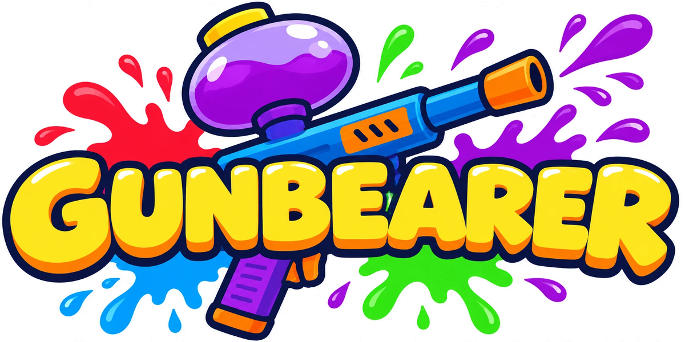

# Gunbearer

Shooter de fiesta en 3D: solo uno tiene el Lanzador, y tenerlo te convierte en el blanco de todos.
Segundo juego de la serie de Yassper Design (después de MAAI). Hecho en Godot 4.5.

## Reglas
- Un solo Lanzador en la partida. El portador dispara bolas de pintura: cada eliminación es 1 punto.
- Los demás van desarmados. Si tocan al portador, le roban el Lanzador.
- El nuevo portador tiene 2 s de inmunidad; el que lo perdió queda aturdido 1 s.
- El portador corre más lento y tiene 5 bolas con recarga.
- La partida dura 3 minutos. Gana quien tenga más puntos.
- Cada personaje pertenece a una de seis clases (Artillero, Velocista, Ladrón, Blindado, Saltarín, Tirador), con una ventaja y un costo.

## Controles
| Acción | Tecla |
|---|---|
| Moverse | WASD |
| Mirar / apuntar | Mouse |
| Disparar | Clic izquierdo |
| Apuntar fino | Clic derecho |
| Saltar | Espacio |
| Dash | Shift |
| Recargar | R |
| Pausa / menú | Esc |
| Salir al menú (con el menú abierto) | Q |

Son los controles de fábrica: se pueden cambiar en **Opciones**, junto con la sensibilidad del mouse, el volumen y la pantalla completa.

## Estado
- [x] Hito 1: moverse, cámara, dash, Lanzador y bolas
- [x] Hito 2: reglas (robo, inmunidad, aturdimiento, puntos, tiempo, reapariciones, HUD)
- [x] Bots básicos (adelantados para poder jugar solo)
- [x] Menú principal: contra bots (cantidad y dificultad), crear partida, unirse
- [x] Hito 3: red local (2 a 8 jugadores, puerto 24570; búsqueda de partidas por UDP 24571)
- [x] Hito 5: pulido (partículas, estela del dash, rachas, trampolines)
- [x] Hito 6: arte (personajes animados y campos vestidos)
- [x] Perfil del jugador (nombre y personaje), sala de espera en lista, tres campos, controles configurables y estadísticas al final

Todos los números del juego están en `autoload/tuning.gd`.

## Red local
- Uno le da a **Crear partida en red local** y los demás a **Unirse a una partida**. Todos en el mismo wifi.
- El host decide los toques, los impactos y los puntos. Cada jugador mueve su propio muñeco.
- Si alguien se va a mitad de partida, un bot ocupa su lugar.
- Al terminar, el host puede lanzar otra ronda o volver a la sala, donde puede entrar gente nueva.
- La primera vez, Windows pregunta si deja pasar a Godot por el firewall: hay que decir que sí.

## Créditos
- **Idea original y dirección:** Jorge Ricardo Cintra Rad
- **Programación:** Jorge Ricardo Cintra Rad y Jesús Luis Pérez Martínez
- **Arte:** Kenney ([Mini Characters](https://kenney.nl/assets/mini-characters), con licencia Creative Commons CC0)
- **Motor:** [Godot Engine](https://godotengine.org/)
- **Sonido y música:** generados por código, sin archivos de audio

---
[Jorge Coffee](https://jorge-coffee.onrender.com/)
